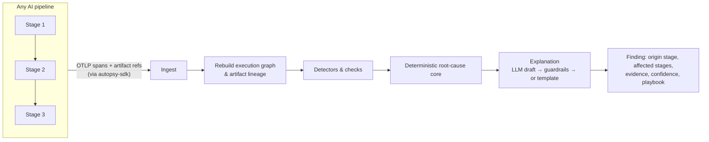

# Pipeline Autopsy

**Finds the stage that actually caused a bad AI pipeline result, not just the stage where it showed up.**

In a multi-stage AI pipeline (OCR → classification → extraction → decision), a wrong answer at the end is usually a *symptom*. The cause may be three stages earlier, for example a permissive OCR check that let a low-confidence value through. Logs and dashboards show where things broke. Pipeline Autopsy works out **why**.

This repository contains two independent systems that talk only through OpenTelemetry traces:

| | What it is |
|---|---|
| [`pipeline-autopsy/`](pipeline-autopsy) + [`autopsy-sdk/`](autopsy-sdk) | The diagnosis service. It ingests OTLP traces, rebuilds the execution graph, follows artifact lineage and separates root causes from downstream symptoms. |
| [`insurance-pipeline/`](insurance-pipeline) | A realistic system to diagnose: a claims-document pipeline with OCR, quality gates, LLM classification and evidence-backed extraction. |

---

## How it works



1. **Instrument.** A pipeline wraps its stages with `autopsy-sdk`, a thin layer over the OpenTelemetry API. It records which artifacts each stage read and wrote, and which checks passed or failed. The SDK never captures document content, prompts or extracted values.
2. **Reconstruct.** The service ingests standard OTLP (`POST /v1/traces`) and rebuilds the run as a DAG, including fan-out stages.
3. **Diagnose.** Detectors flag suspicious behaviour, and the **deterministic core** assigns roles (origin, propagated, symptom) by following lineage backwards. If the trace lacks the evidence to decide, it returns `INSUFFICIENT_EVIDENCE` instead of guessing.
4. **Explain.** An LLM can optionally draft the explanation text. The draft must pass guardrails (G1–G9), or the deterministic template is published instead. **The LLM never changes the root cause, classification, confidence or verdict.**

## The claims pipeline it diagnoses

`insurance-pipeline/` is built to *fail loudly*:

- **OCR quality gate.** Pages with low recognition confidence, too few words or too many suspicious characters never reach extraction.
- **Classify, then extract.** Each document is checked against its declared type first. A mismatch blocks that document instead of extracting against the wrong schema.
- **Evidence-backed fields.** Every extracted value must cite an exact quote and page, which application code verifies. Missing or conflicting fields are marked as such and never guessed.
- **Deterministic validation.** Strict schemas, date and currency normalization, and bill arithmetic checks run after the model and before anything is accepted.

## Status

| | |
|---|---|
| Diagnosis service + SDK | Working prototype · 188 service tests + 20 SDK tests · recorded diagnosis cases (`toy_healthy`, `toy_publish_timeout`, `toy_short_body`) checked in CI |
| Claims pipeline | Working prototype through intake, OCR, classification, extraction, validation and rules · backend test suite in CI |
| Explanation-quality eval (L2) | Harness built; recorded cases are awaiting review, so no L2 metrics are reported yet |
| Deployment | Local only (Docker Compose). **Synthetic data only**: no real claims or medical documents |

## Run it

```bash
# Diagnosis service (API on :8080, docs at /docs)
cd pipeline-autopsy && cp .env.example .env && docker compose up --build

# Claims pipeline (+ Jaeger trace UI)
cd insurance-pipeline && docker compose up
```

Tests:

```bash
cd autopsy-sdk && pip install -e ".[dev]" && pytest -q
cd pipeline-autopsy && pip install -r requirements.txt pytest && pytest tests -q && python evals/run_l1.py
cd insurance-pipeline/backend && pip install -r requirements.txt && pytest -q   # needs Tesseract on PATH
```

A Gemini API key is optional. Without one, extraction tests use recorded synthetic responses and explanations use the deterministic template.

## Design notes

- [`shared-docs/TRACE_CONTRACT.md`](shared-docs/TRACE_CONTRACT.md): the span and attribute contract between any pipeline and Autopsy
- [`shared-docs/SYSTEM_ARCHITECTURE.md`](shared-docs/SYSTEM_ARCHITECTURE.md): boundaries and milestones
- [`pipeline-autopsy/playbooks/`](pipeline-autopsy/playbooks): remediation playbooks attached to findings
- Interactive walkthrough (synthetic, front-end only): [Autopsy_demo_raj](https://github.com/RajMagdum05/Autopsy_demo_raj)

## Limitations

- No durable job queue. Claims processing runs inside the API request.
- Diagnosis is validated on recorded toy traces and the claims pipeline, not on third-party production pipelines.
- The claims pipeline makes no coverage or eligibility decisions intended for real use.

## Credits

Built by Raj Magdum. The original project website was contributed by Rehan Sanadi.
