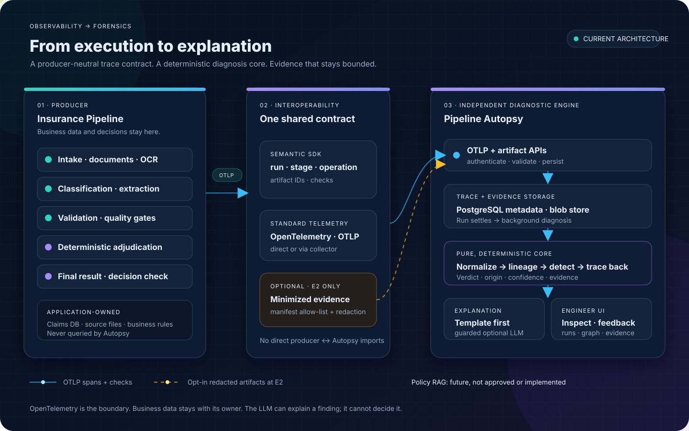

<div align="center">

# Pipeline Autopsy

### Find the first bad stage. Follow the evidence. Keep the verdict deterministic.

**A forensic diagnosis engine for multi-stage AI pipelines.** Pipelines emit OpenTelemetry traces; Autopsy reconstructs data lineage, tests the evidence, and points engineers to the earliest supported cause.

[Architecture](#architecture) · [Data boundaries](#data-boundaries) · [Run locally](#run-locally) · [Tests and evaluation](#tests-and-evaluation) · [Roadmap](#roadmap)

</div>

<p align="center">
  
</p>

## The system, at a glance

Pipeline Autopsy is the analysis side of a deliberately split system:

- **Insurance Pipeline** is one example producer. It owns claim intake, document processing, extraction, validation, deterministic adjudication, and final results.
- **`autopsy-sdk`** gives a producer small, semantic calls for runs, stages, operations, artifacts, and checks. It exports standard OpenTelemetry; it does not contain insurance logic.
- **Pipeline Autopsy** accepts the trace and any explicitly allowed evidence, rebuilds the execution and artifact graph, diagnoses failures, and serves the findings in its API and React UI.

The insurance service and Autopsy do not import one another or share a database. Their integration is the versioned trace contract and the registered pipeline manifest.

## Architecture

The animated map shows the current implemented boundary. The bright moving dots represent trace flow; the second, opt-in path represents redacted evidence at E2.

1. **Instrument the work.** A producer uses `autopsy-sdk` to describe one run and its item-scoped or run-scoped stages. Checks capture silent validation failures that ordinary exception telemetry misses.
2. **Send standard telemetry.** The application-owned OpenTelemetry provider exports spans over OTLP/HTTP, directly or through a customer collector.
3. **Add evidence only by choice.** E0 sends spans; E1 adds checks; E2 permits only manifest-allow-listed evidence. Uploads are additionally gated by `AUTOPSY_EVIDENCE_LEVEL`; evidence content is minimized or redacted before leaving the producer.
4. **Diagnose with deterministic code.** Autopsy validates the trace, expands fan-out stages, connects artifact IDs into lineage, runs generic detectors and consistency checks, then traces evidence back to the earliest supported cause.
5. **Explain without changing the finding.** A deterministic explanation template is the safe baseline. An optional Gemini draft must pass guardrails; otherwise Autopsy falls back to the template. The model cannot change the verdict, origin, classification, or confidence.

The core diagnosis package is kept pure: no database, network, clock, or LLM calls. The API, persistence, worker, explanation service, and UI surround it as a modular monolith.

## Data boundaries

| Component | Owns | Does not own |
|---|---|---|
| Insurance Pipeline | Claims database, source documents, extracted facts, and business decisions | Autopsy diagnosis or evidence database |
| `autopsy-sdk` | Stable telemetry semantics and artifact references | Business rules or storage |
| Pipeline Autopsy | Trace metadata, diagnosis, findings, explanations, feedback, and opt-in evidence blobs | Claim records, insurance APIs, or producer database access |
| Shared contract | Trace fields, manifest shape, artifact identity, and privacy rules | Runtime state |

**Privacy defaults:** artifact identifiers can travel in spans; document text and extracted values do not. E2 is opt-in and bounded by both the producer configuration and the manifest. The SDK rejects artifact uploads unless the configured level is E2.

## What is implemented

- **Producer workflow:** claim intake and document processing, OCR quality gates, classification and extraction, application validation, deterministic adjudication, and final-result checks.
- **Diagnosis:** OpenTelemetry OTLP ingestion, manifest validation, execution and fan-out reconstruction, artifact lineage, generic checks and consistency validation, root-cause analysis, and L1 golden evaluation.
- **Investigation:** FastAPI read APIs, persisted findings, a React run list and investigation view, evidence display, and feedback.
- **MVP+1 explanation support:** evidence bundles, deterministic templates, guarded optional Gemini drafting, and keyed playbook retrieval.
- **SDK and contract:** a standalone SDK package and the shared `pipeline-trace/3` contract.

The L2 evaluation runner is in place, but the current toy `expected.yaml` files are drafts rather than owner-approved explanation samples. The last offline run therefore had **zero eligible L2 cases**; no explanation-quality rates are claimed. See [`pipeline-autopsy/README.md`](pipeline-autopsy/README.md#explanation-quality-evaluation-l2) and [`evals/run_l2.py`](pipeline-autopsy/evals/run_l2.py).

## Roadmap

The codebase contains the trace diagnosis, feedback, playbook, and guarded explanation components tracked across M3/M4 and MVP+1. The [roadmap](planning/08_roadmap/70_task_list.md) records remaining integration and acceptance gates, including the combined root Compose demo. The M5 Policy RAG extension is **not implemented or approved yet**. Its planning-only RAG-00 proposal is a required design and owner-approval gate before any RAG implementation. Policy knowledge belongs to the Insurance Pipeline; Autopsy’s playbooks remain a separate diagnostic feature.

For architecture decisions and implementation status, start with:

- [Target architecture](planning/03_architecture/20_target_architecture.md)
- [Architecture decisions](planning/03_architecture/21_architecture_decisions.md)
- [Trace contract v3](shared-docs/TRACE_CONTRACT.md)
- [Manifest specification](shared-docs/MANIFEST_SPEC.md)
- [Task roadmap](planning/08_roadmap/70_task_list.md)
- [Milestones and definition of done](planning/08_roadmap/72_milestones_and_done.md)

## Run locally

Each application can run independently. The Insurance Pipeline emits telemetry; Pipeline Autopsy receives and diagnoses it.

### Pipeline Autopsy

```powershell
cd pipeline-autopsy
Copy-Item .env.example .env
docker compose up --build
```

Open the API at [http://localhost:8080/docs](http://localhost:8080/docs) and the Autopsy UI at [http://localhost:8080/ui/](http://localhost:8080/ui/).

### Insurance Pipeline

```powershell
cd insurance-pipeline
Copy-Item .env.example .env
docker compose up --build
```

See [`insurance-pipeline/README.md`](insurance-pipeline/README.md) for intake, configuration, and local frontend details. A combined root Compose stack is a roadmap item; start the projects independently unless using a dedicated demo setup.

### Tests and evaluation

Run component tests from their project directories:

```powershell
cd pipeline-autopsy
pytest tests/

cd ..\autopsy-sdk
pytest

cd ..\insurance-pipeline\backend
pytest tests/
```

The recorded diagnosis evaluation is deterministic and offline:

```powershell
cd pipeline-autopsy
python evals/run_l1.py
python evals/run_l2.py
```

L1 measures diagnosis correctness. L2 measures explanations only and includes cases only after their expected findings and evidence have been reviewed and explicitly approved. Live L2 calls require explicit `--live` and user-supplied Gemini configuration; a model judge is advisory, never ground truth.

## Repository map

```text
autopsy-sdk/          Producer-side OpenTelemetry and evidence SDK
insurance-pipeline/   Example producer and insurance-owned business workflow
pipeline-autopsy/     Independent trace diagnosis API, worker, UI, and evals
shared-docs/          Shared trace contract, manifest, and architecture entry points
planning/             Canonical architecture decisions, task prompts, and roadmap
```

---

<div align="center">

**Observe the run. Reconstruct the data path. Find the earliest supported cause.**

</div>
