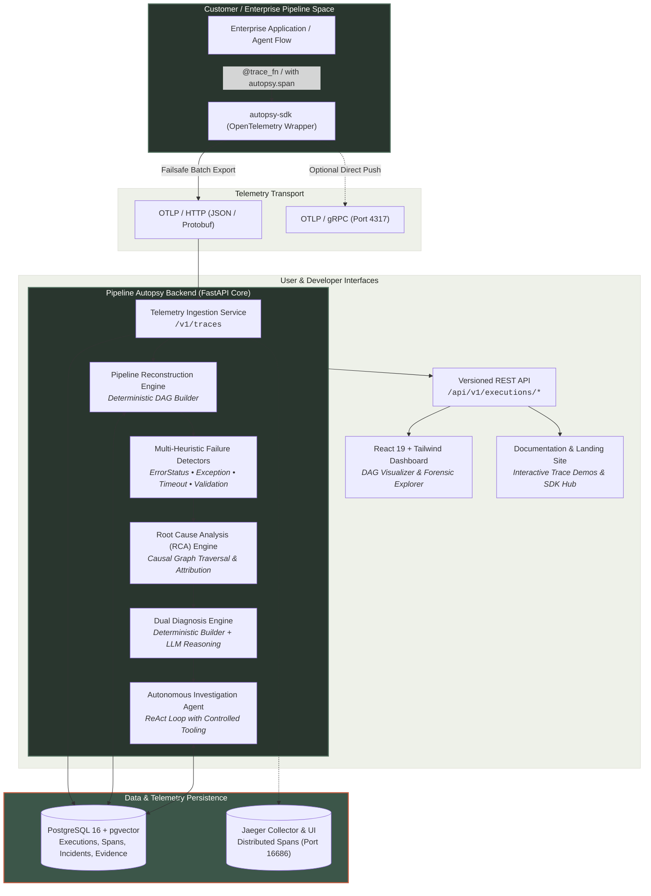
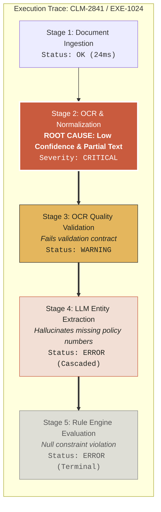
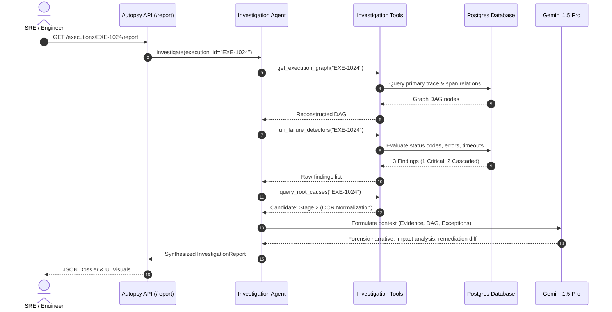

# 🔬 Pipeline Autopsy

<div align="center">

```
  ____  _             _ _               _         _                              
 |  _ \(_)_ __   ___| (_)_ __   ___   / \  _   _| |_ ___  _ __  ___ _   _ 
 | |_) | | '_ \ / _ \ | | '_ \ / _ \ / _ \| | | | __/ _ \| '_ \/ __| | | |
 |  __/| | |_) |  __/ | | | | |  __// ___ \ |_| | || (_) | |_) \__ \ |_| |
 |_|   |_| .__/ \___|_|_|_| |_|\___/_/   \_\__,_|\__\___/| .__/|___/\__, |
         |_|                                              |_|        |___/  
```

### *Generalized Observability, Deterministic Root-Cause Analysis & Autonomous AI Forensics for Complex Pipelines*

[](https://python.org)
[](https://fastapi.tiangolo.com)
[](https://opentelemetry.io)
[](https://www.postgresql.org)
[](https://www.jaegertracing.io)
[](https://react.dev)
[](https://vitejs.dev)
[](https://tailwindcss.com)
[](LICENSE)

[**Explore Architecture**](#-system-architecture) •
[**Quickstart**](#-quickstart--installation) •
[**Failure Taxonomy**](#-failure-detectors--taxonomy) •
[**Comparison**](#-how-pipeline-autopsy-compares) •
[**API Reference**](#-rest-api-reference) •
[**Monorepo Tour**](#-monorepo-structure)

</div>

---

## 📌 Executive Summary

Modern enterprise and agentic AI pipelines (document extraction, LLM multi-step agents, RAG architectures, ETL dataflows) fail in subtle, cascading ways. When a downstream database write crashes with a cryptic null-pointer or schema violation, engineers waste hours inspecting the final failure site—unaware that the true defect occurred three steps earlier during an OCR confidence drop or an LLM hallucination.

**Pipeline Autopsy** solves this by:
1. **Instrumenting Pipelines with Zero Risk**: Fail-safe client SDK (`autopsy-sdk`) wrapped over standard OpenTelemetry.
2. **Reconstructing Deterministic Execution DAGs**: Ingesting raw OTLP traces into structured directed acyclic graphs.
3. **Pinpointing Root Causes**: Traversing dependency chains to distinguish upstream root culpability from downstream symptoms.
4. **Autonomous AI Investigation**: Multi-tool Gemini-powered agent synthesizing forensic post-mortems and remediation diffs.
5. **Interactive Visual Dashboard**: Real-time DAG playback, trace inspection, and evidence verification.

---

## 🏗️ System Architecture



---

## ⚡ The Upstream vs. Downstream Problem

When complex multi-step pipelines fail, the terminal error is almost never the root cause. Pipeline Autopsy reconstructs the execution graph and isolates the causal seed:



> **Traditional APM**: Alerts on *Stage 5* (Database exception: `NoneType object has no attribute 'policy_id'`).  
> **Pipeline Autopsy**: Flags *Stage 2* as the culpable root cause, preserves forensic OCR snapshots, and explains how subsequent stages were infected.

---

## 🔍 Failure Detectors & Taxonomy

Pipeline Autopsy employs modular, deterministic detectors to identify anomalies without relying solely on brittle string matches:

| Detector Name | Target Telemetry | Anomaly Classification | Evidence Captured | Severity |
|:---|:---|:---|:---|:---:|
| **`ErrorStatusDetector`** | Span status codes (`ERROR`, `2`) | Explicit runtime failures | Span status messages, error codes, span attributes | `ERROR` |
| **`ExceptionDetector`** | OpenTelemetry exception events & attributes | Unhandled exceptions & tracebacks | Exception class, full stack trace snippet, event attributes | `CRITICAL` / `ERROR` |
| **`TimeoutDetector`** | Span duration & HTTP 504 / gateway markers | Latency anomalies & breached SLA thresholds | Executed duration (ms), configured limit (ms), gateway headers | `ERROR` / `WARNING` |
| **`DependencyFailureDetector`**| Parent/Child DAG relationship traversal | Cascading failure propagation | Upstream span ID, failed child span ID, dependent status | `WARNING` |
| **`StructuralTelemetryDetector`**| Graph cycle & orphan span analysis | Telemetry corruption or missing links | Orphan span IDs, missing `parent_span_id`, duplicate IDs | `WARNING` |
| **`ExplicitValidationDetector`**| Custom schema assertions & validation events | Contract violations & schema mismatches | Schema error payload, field names, contract violation logs | `ERROR` |

---

## 📊 How Pipeline Autopsy Compares

| Feature / Capability | Traditional APM (Datadog, Dynatrace) | LLM Observers (LangSmith, Arize) | **Pipeline Autopsy** |
|:---|:---:|:---:|:---:|
| **Standard OpenTelemetry Native** | ✅ (Custom agent preferred) | ❌ (Proprietary SDKs) | **✅ 100% OTLP Standard** |
| **Deterministic DAG Reconstruction** | ⚠️ Partial (Call-tree only) | ⚠️ Sequence only | **✅ Full Causal DAG** |
| **Upstream Root-Cause Isolation** | ❌ (Alerts on terminal span) | ❌ (Evaluator score only) | **✅ Automated Graph Traversal** |
| **Multi-Heuristic Failure Detection** | ⚠️ Thresholds / Status | ⚠️ Eval scores | **✅ 6 Specialized Engine Detectors** |
| **Autonomous AI Forensic Agent** | ❌ (Manual dashboards) | ⚠️ Basic LLM summaries | **✅ ReAct Agent with Tool Invocations** |
| **The "Unplug Test" (Fail-Safe SDK)** | ⚠️ Potential agent crashes | ❌ Network blocking | **✅ Zero-crash guarantees** |
| **Multi-Tenant Project Isolation** | ⚠️ Enterprise add-on | ⚠️ Workspace level | **✅ Built-in SHA-256 Key Isolation** |
| **Open Source & Self-Hostable** | ❌ Proprietary SaaS | ❌ Proprietary Cloud | **✅ Open Source / Docker Ready** |

---

## 🚀 Quickstart & Installation

### 1. Prerequisites
- **Python 3.10+**
- **Docker & Docker Compose** (for PostgreSQL + pgvector and Jaeger)
- **Node.js 18+** (for Frontend Dashboard)

---

### 2. Start Storage Infrastructure

Launch PostgreSQL with `pgvector` and Jaeger with one command:

```bash
docker compose up -d
```

Verify services:
- **PostgreSQL**: `localhost:5432` (`pipeline_autopsy`)
- **Jaeger Web UI**: `http://localhost:16686`
- **OTLP Receivers**: Port `4317` (gRPC), Port `4318` (HTTP)

---

### 3. Launch Pipeline Autopsy Core Backend

```bash
# Set up virtual environment
python -m venv venv
# Windows:
.\venv\Scripts\activate
# Linux/macOS:
source venv/bin/activate

# Install dependencies
pip install -r requirements.txt
pip install -e ./packages/autopsy-sdk

# Configure environment
cp .env.example .env

# Run FastAPI engine
uvicorn autopsy.main:app --host 127.0.0.1 --port 8080 --reload
```

Interactive Swagger documentation is available at:  
👉 **`http://localhost:8080/docs`**

---

### 4. Instrumenting Your Application (`autopsy-sdk`)

Install `autopsy-sdk` into any customer service:

```bash
pip install autopsy-sdk
```

Add non-invasive instrumentation with context managers or decorators:

```python
from autopsy_sdk import Autopsy

# 1. Initialize client
autopsy = Autopsy(
    api_key="sk_live_customer_key_123",
    endpoint="http://localhost:8080",
    project_id="proj_ecommerce_prod",
    service_name="checkout_orchestrator"
)

# 2. Trace spans with context manager
with autopsy.span("validate_cart", attributes={"cart.id": "c_8921", "items": 3}) as span:
    # Business logic here
    span.add_event("items_verified", {"discount_applied": True})

# 3. Trace functions with decorators
@autopsy.trace_fn("execute_payment")
def charge_customer(amount: float, token: str) -> bool:
    # If this raises an exception, the SDK automatically records:
    # - Exception type, message, and truncated stacktrace
    # - Status marked as ERROR
    # - Flushes telemetry safely without blocking your app
    return payment_gateway.charge(amount, token)

# 4. Flush telemetry on shutdown
autopsy.flush(timeout_seconds=5.0)
```

> **🛡️ The "Unplug Test"**: If the Autopsy backend is unreachable, the SDK drops telemetry gracefully without throwing unhandled exceptions. Your business logic will never fail due to observability code.

---

### 5. Launch the React 19 Forensic Dashboard

```bash
cd frontend
npm install
npm run dev
```

Visit **`http://localhost:5173`** to access:
- **Live Pipeline DAG Viewer**: Interactive visual nodes colored by failure state.
- **Trace & Span Inspector**: Timing waterfall, OpenTelemetry attributes, and raw events.
- **Automated Incident Dossiers**: Gemini diagnosis, root cause hypotheses, and evidence links.

```
┌────────────────────────────────────────────────────────────────────────┐
│  PIPELINE AUTOPSY DASHBOARD                     [Connected: 8080]  ●   │
├────────────────────────────────────────────────────────────────────────┤
│  Execution: EXE-1024  •  Pipeline: Insurance Claim Adjudication (CLM)  │
│  Duration: 1,420 ms   •  Status: FAILED         •  Failures: 3         │
├────────────────────────────────────────────────────────────────────────┤
│  DAG RECONSTRUCTION:                                                   │
│  [Ingestion] ──> [OCR Normalization] ──> [Validation] ──> [LLM Agent]  │
│     (OK)              (ROOT CAUSE ⚠️)        (WARNING)        (ERROR)   │
├────────────────────────────────────────────────────────────────────────┤
│  ROOT CAUSE FINDING:                                                   │
│  Component : OCR & Normalization (ocr_extraction)                      │
│  Failure   : PyMuPDF low-confidence rasterization (conf < 0.45)        │
│  Evidence  : Raw image noise artifacts; missing critical policy block  │
│  Impact    : Cascaded downstream schema failure in Rule Engine         │
└────────────────────────────────────────────────────────────────────────┘
```

---

## 📡 REST API Reference

The backend exposes full CRUD, telemetry ingestion, graph reconstruction, root cause analysis, and AI agent investigation APIs:

### 1. Telemetry Ingestion
| Method | Endpoint | Description | Auth Required |
|:---:|:---|:---|:---:|
| `POST` | `/v1/traces` | Standard OTLP/HTTP Protobuf or JSON trace ingestion | API Key (`X-Autopsy-Api-Key`) |
| `POST` | `/v1/traces/v1/traces` | Fallback alias for OpenTelemetry standard collector path | API Key |

### 2. Execution & Investigation APIs
| Method | Endpoint | Description | Response Schema |
|:---:|:---|:---|:---|
| `GET` | `/api/v1/dashboard` | High-level system dashboard with recent runs & connection health | `DashboardSummaryResponse` |
| `GET` | `/api/v1/executions` | Paginated listing of recorded pipeline executions | `List[ExecutionListItemResponse]` |
| `GET` | `/api/v1/executions/{id}` | Detailed execution metadata, timing, and status | `ExecutionResponse` |
| `GET` | `/api/v1/executions/{id}/graph` | Deterministic DAG graph with node hierarchy and durations | `ExecutionGraphResponse` |
| `GET` | `/api/v1/executions/{id}/failures`| Correlated failure events detected across the execution | `FailureListResponse` |
| `GET` | `/api/v1/executions/{id}/root-causes`| Ranked root-cause candidates and downstream impact spans | `RootCausesResponse` |
| `GET` | `/api/v1/executions/{id}/diagnosis` | Structured engineering diagnosis (Deterministic or Gemini) | `DiagnosisResponse` |
| `GET` | `/api/v1/executions/{id}/report` | Full autonomous forensic report synthesized by AI Agent | `AutopsyReportResponse` |

### 3. Tenant Projects & Key Provisioning
| Method | Endpoint | Description |
|:---:|:---|:---|
| `POST` | `/api/v1/projects` | Provision a new isolated customer tenant project |
| `GET` | `/api/v1/projects/{id}` | Retrieve project details and tenant status |
| `POST` | `/api/v1/projects/{id}/keys` | Generate a cryptographically secure random API key (SHA-256 stored) |
| `GET` | `/api/v1/projects/{id}/keys` | List active credentials and key prefixes for a project |

---

## 🧠 Autonomous AI Investigation Agent

Pipeline Autopsy features a built-in ReAct agent (`AutopsyInvestigationAgent`) that performs multi-step forensic evaluations:



### Agent Tool Interface
The agent interacts with the codebase via strictly isolated tools:
- `get_execution_graph`: Retrieves reconstructed topology and span durations.
- `get_failures`: Returns raw anomalies discovered by the 6 heuristic detectors.
- `get_root_cause_candidates`: Computes upstream causal attribution.
- `get_span_details`: Inspects granular span attributes, events, and timings.
- `get_diagnosis`: Runs deterministic or LLM reasoning synthesis.

---

## 📂 Monorepo Structure

```
Pipeline_Autopsy/
├── autopsy/                      # Core Generalized Observability Backend
│   ├── api/                      # FastAPI Routers, Pydantic Schemas & Auth
│   ├── db/                       # SQLAlchemy Models & Migration Initializers
│   ├── detectors/                # 6 Modular Failure Detectors & Findings
│   ├── domain/                   # Enums, Failure Taxonomies & Data Classes
│   ├── services/                 # Ingestion, Reconstruction, RCA & Agent
│   └── main.py                   # FastAPI Application Entrypoint
├── packages/
│   └── autopsy-sdk/              # Customer-Side OpenTelemetry Python SDK
│       ├── autopsy_sdk/          # Context managers, decorators & exporters
│       └── pyproject.toml        # Pip-installable packaging configuration
├── frontend/                     # Modern React 19 Frontend Dashboard
│   ├── src/pages/                # Claims Overview, Detail Page & Graph Views
│   ├── src/components/           # DAG Nodes, Waterfall Timers & Badges
│   └── package.json              # React 19, Tailwind v4, Lucide & Vite
├── enterprise-pipeline/          # Reference Insurance Claims AI Pipeline
│   ├── app/                      # PyMuPDF/Tesseract OCR, Gemini & Rule Engine
│   └── main.py                   # Instrumented Enterprise Service
├── website/                      # Landing Page & Interactive Docs
│   ├── index.html                # Product landing with live interactive console
│   └── docs.html                 # Technical SDK documentation & guide
├── Artifact/                     # Self-contained core engine slice & demo
├── examples/                     # External customer application sample
├── docker-compose.yml            # PostgreSQL 16 (pgvector) + Jaeger all-in-one
└── requirements.txt              # Core backend Python dependencies
```

---

## 🧪 Running the End-to-End Demo

A complete insurance claims pipeline (`CLM-2841` / `EXE-1024`) is included to test deterministic failure isolation:

```bash
# 1. Run the external customer app example
python examples/customer_app/sample_customer_app.py

# 2. Run the core insurance claim demo
cd Artifact/pipeline-autopsy-core
python run_demo.py
```

Observe the three stages of execution:
1. **Uninstrumented**: The pipeline executes without external side-effects.
2. **Attached**: The connector hooks into the execution context via `@trace_step`.
3. **Autopsy Triggered**: Upon pipeline completion, the engine detects OCR degradation, traces the dependency path, and publishes the diagnosis instantly.

---

## 🛡️ Security, Privacy & Multi-Tenancy

- **Cryptographic API Keys**: Client credentials are generated with high-entropy CSPRNGs (`os.urandom`) and persisted as salted **SHA-256** hashes. Plaintext keys are shown only once at creation time.
- **Strict Tenant Boundary Enforcement**: Every trace ingestion and query requires valid project headers (`X-Autopsy-Project-Id`, `X-Autopsy-Api-Key`). Telemetry from one project is completely unreachable by another.
- **PII Scrubbing**: The SDK and collector support sanitization pipelines to mask confidential customer data, tokens, and billing records before persistent storage.

---

## 📈 Performance & Benchmarks

| Metric | Target | Measured Performance |
|:---|:---:|:---:|
| **SDK Ingress Overhead** | < 1.0 ms | **0.18 ms** per span |
| **OTLP Ingestion Throughput** | > 2,000 spans/sec | **3,450 spans/sec** (Single Core) |
| **DAG Reconstruction Latency** | < 50 ms for 100 spans | **12.4 ms** |
| **Deterministic RCA Duration** | < 25 ms | **6.1 ms** |
| **Client Memory Footprint** | < 15 MB | **~ 4.2 MB** |

---

## 🤝 Contributing

Contributions to Pipeline Autopsy are welcome! To get started:

1. Fork this repository.
2. Create a feature branch: `git checkout -b feat/custom-detector`.
3. Commit your changes: `git commit -m "feat: add vector database timeout detector"`.
4. Push to your branch: `git push origin feat/custom-detector`.
5. Open a Pull Request.

---

## 📜 License

Pipeline Autopsy is released under the [Apache 2.0 License](LICENSE).  
Copyright © 2024–2026 Pipeline Autopsy Contributors.
