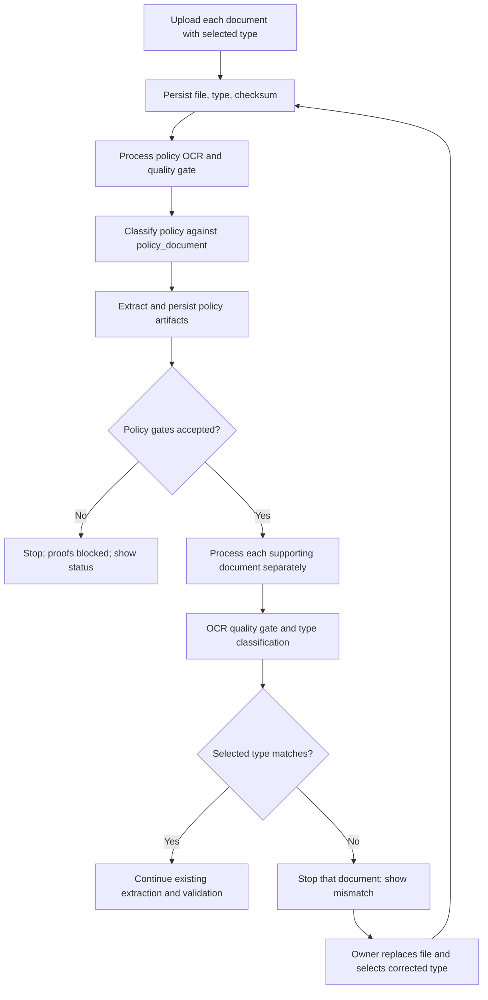

# Insurance Pipeline MVP

The previous pipeline is preserved in `../insurance-pipeline-old/`. This clean build follows the six-stage modular monolith structure. M1 covers claim intake; M2 covers OCR, semantic document content validation, and persisted structured extraction.

## M1: Claim and Document Intake

`POST /claims` and the compatibility route `POST /api/v1/claims` accept the existing policyholder claim form and document upload fields. The module reuses the prior PostgreSQL table and model design (`claims`, `claim_documents`, `legacy_claims`, and `documents`) and preserves its form validations and file checks. Uploads are stored under `storage/claims/<claim_id>/`; the response includes `claim_id`, `document_ids`, and status `RECEIVED`.

PostgreSQL is the Docker default. Local development defaults to SQLite using the same tables and columns for convenient testing.

## M2: Document Processing

`POST /claims/{claim_id}/documents/process` runs document text processing synchronously. It resolves persisted document roles, requires exactly one PDF policy and at least one proof, validates paths and upload checksums, then processes and persists the policy before starting proofs. Each proof is handled independently and failures produce a `PARTIAL` run. Repeating a successful `config_version` returns the same run; use a new `config_version` to preserve a deliberate reprocessing attempt. The legacy `POST /documents/process` route now returns a failure directing callers to the claim-scoped route because a single-document request cannot enforce the policy gate.

Each upload retains its selected `document_type` (`policy_document` or one of the six supporting types, including `other_supporting_document`). Classification runs separately for every document after its OCR quality gate, compares detected content with that persisted selection, and blocks extraction/progression on mismatch, ambiguity, unsupported content, or failure. The frontend links to `/claims/{claim_id}` after intake, where **Check document types** runs processing and displays each document's selected type, detected type, version, and disposition. A mismatch can be corrected by replacing the file and explicitly selecting its corrected type; replacement files are immutable and the prior file metadata and OCR result are retained in `claim_document_versions`. This stage does not implement a human review interface.

The response to claim creation includes an opaque owner token. The frontend keeps it in session storage and supplies it as a bearer token to `GET /claims/{claim_id}/documents/status`, `PUT /claims/{claim_id}/documents/{document_id}`, and the claim-scoped processing route. Only a hash is stored in the database. These owner-scoped endpoints return 404 for missing or invalid access tokens.



Processing records are stored in `document_processing_runs`, `processed_documents`, and `processed_document_pages`. Raw page text and layout are kept separately per source document and attempt; uploaded files are read-only inputs. Tesseract word scores from `image_to_data` are kept separately from application quality metrics. Native PyMuPDF text has unavailable recognition confidence. The existing quality validator calculates page-level metrics and reasons; acceptance, retry, and review disposition are persisted separately. Defaults reuse the existing 15-character, 3-word, 60/35 confidence thresholds; they are configurable starting points, not industry standards. `OCR_MAX_ATTEMPTS` is bounded to 1–2 attempts.

Document limits and routing defaults can be adjusted with `DOCUMENT_MAX_BYTES`, `DOCUMENT_MAX_PAGES`, `DOCUMENT_MAX_RENDER_PIXELS`, `OCR_RENDER_DPI`, `OCR_NATIVE_MIN_CHARS`, `OCR_NATIVE_MIN_WORDS`, `OCR_PAGE_TIMEOUT_SECONDS`, and `TESSERACT_LANGUAGE`. Quality gates can be configured with `OCR_QUALITY_MIN_CHARACTERS`, `OCR_QUALITY_MIN_WORDS`, `OCR_CONFIDENCE_PASS`, `OCR_CONFIDENCE_RETRY`, `OCR_LOW_CONFIDENCE_CUTOFF`, `OCR_MAX_LOW_CONFIDENCE_RATIO`, and `OCR_MAX_SUSPICIOUS_CHAR_RATIO`. The selected values are recorded on each processing attempt.

There is no durable job queue in this application, so this route currently performs parsing and OCR in the API request. The Tesseract page timeout does not impose a hard timeout on PyMuPDF parsing or rendering. Deployments should add durable background execution and process-level resource limits before treating this as production-ready.

The Python dependencies include PyMuPDF and pytesseract. Local image/scanned PDF OCR also requires the Tesseract executable on `PATH` (or `TESSERACT_CMD`); the API Docker image installs Tesseract and its English language data. On this Windows workspace, a checksum-verified Tesseract 5.5.3 runtime is available under `backend/.local-tools/tesseract` (ignored from source control); set `TESSERACT_CMD` to that `tesseract.exe` when running the backend locally. English (`eng`) and orientation (`osd`) trained data are included.

## M2: Document content validation and structured extraction

After the OCR quality gate accepts each document, `backend/app/information_extraction/content_service.py` classifies its content against the persisted declared role, verifies page/snippet evidence in application code, and only then performs its document-specific extraction. Classification uses `backend/app/information_extraction/prompts/classification_v1.txt`. Extraction uses the shared safety contract in `prompts/extraction_v2/base.txt` plus exactly one versioned type-specific template (`policy_document.txt`, `hospital_bill.txt`, `fir_accident_report.txt`, `medical_report.txt`, `discharge_summary.txt`, `repair_estimate.txt`, or `other_supporting_document.txt`). Pydantic response schemas and allowed field catalogs are in `backend/app/information_extraction/schemas.py`; policy wording/schedule/endorsement subtypes select additional strict schema variants. Missing fields are materialized as `missing`; found/conflicting values require supported quotes. Raw OCR remains unchanged.

`POST /claims/{claim_id}/documents/process` runs policy OCR quality, content classification, document-specific extraction, and application validation in that order. Only the accepted classification and current OCR attempt/checksum can reach extraction. Extraction sends one document's page-labelled text per Gemini request batch, never combines policy and proof text, and merges only batches from that same document. Every expected page is tracked; an oversized page fails to review instead of being truncated. `EXTRACTING` and `VALIDATING` states are persisted so the authorized status page can show progress. The policy extraction and validation artifacts are committed before any proof is processed; policy failure/review blocks all proofs. Each proof is then extracted and persisted independently, so one proof's failure does not replace another's result.

The application validator runs after Gemini and before extraction facts are marked complete. `ExtractionValidationReport` stores claim/document IDs, attempt number, input checksum, validator/configuration versions, timestamps, overall disposition (`accepted`, `review_required`, or `extraction_failed`), individual `pass`/`fail`/`not_evaluated` checks, and concise issue codes. It checks strict Pydantic structure, allowed field names, field-state/value consistency, page coverage, exact whitespace-normalized quote support, raw-value presence in cited quotes, canonical/unambiguous dates, Decimal monetary normalization, explicit currency for bill reconciliation, and policy/bill date ordering. Ambiguous dates and raw/normalized amount mismatches require review; original source values remain unchanged. Unknown fields and malformed field-state representations block acceptance as extraction failures. Conflicts and unsupported evidence require review.

Bill arithmetic runs only when subtotal, total, explicit currency, and at least one explicitly extracted tax/discount/credit component are available. It compares subtotal + taxes - discounts - credits with the reported total and does not add deposits or sum line items. Missing/ambiguous inputs produce `not_evaluated`. Currency tolerances default to 0.01 for INR/USD/EUR/GBP and 1 for JPY; deployments can override with `EXTRACTION_CURRENCY_TOLERANCE_<ISO_CODE>`. These are configurable provisional defaults for this implementation, not industry standards; validate them against the product's supported currency and billing rules before production. An arithmetic discrepancy preserves all source values and requires review; it does not imply fraud.

Classification, extraction, and application-validation artifacts persist separately in the shared `document_semantic_artifacts` table, linked to `processed_documents` (attempt), claim, legacy document ID, checksum, model ID, prompt/schema version, status, and timestamps. This shared per-attempt table is the chosen design; JSON payloads carry document-type-specific Pydantic outputs, and no proof documents share a payload. The accepted extraction and its validation report are committed in the same database transaction. Reprocessing uses a new `config_version` and preserves prior runs/artifacts; cache keys also include extraction-prompt and validator versions so a validator update forces revalidation. Replacing an upload changes the checksum and invalidates the prior result for status display. Review/invalid candidate facts are omitted by default; set `EXTRACTION_RETAIN_REVIEW_CANDIDATES=true` only when a controlled retention policy authorizes retaining them. Validation reasons and technical errors are stored separately. The status API returns field data only when classification is accepted, extraction is `complete`, application validation is `passed`, and all artifact checksums and document/claim identifiers match the current attempt.

The `/claims/{claim_id}` frontend presents separate policy and supporting-document sections. For each currently validated document, it displays the accepted fields, missing/conflicting state, evidence quote and source page, and extraction warnings. It also distinguishes accepted, review-required, extraction-failed, and technical-failure states and displays safe field-level issue messages. Candidate payloads from rejected, stale, or review-required results are not displayed as accepted information. Processing failures remain distinct from extraction review states. Candidate retention remains disabled by default; configure database access and retention according to the deployment's privacy policy. No claim eligibility or coverage decisions are made here.

Gemini uses the server-side `GEMINI_API_KEY` (legacy `GOOGLE_API_KEY` is also read) and `google-genai`; the default model is `gemini-3.8-flash`, adjustable with `GEMINI_MODEL`. The request adapter uses Gemini's JSON Schema response field, removes unsupported Pydantic keywords and large `maxItems` caps (the strict local Pydantic models still enforce their limits), requires nonempty facts and evidence, and limits field names to the selected document's allowed catalog. Classification component-level evidence is omitted from the remote schema to keep nesting within the tested limit; top-level classification evidence remains required and verified, and any component evidence returned is still locally checked. Responses are validated against the original strict Pydantic classes. Complete pages are batched (`CONTENT_MAX_BATCH_CHARS=24000`, `CONTENT_MAX_BATCH_PAGES=4`); an over-limit page is sent to review instead of truncated. Requests use `GEMINI_REQUEST_TIMEOUT_SECONDS=45`, at most two application-level transient attempts (`GEMINI_MAX_ATTEMPTS`), and a process-local concurrency cap (`GEMINI_MAX_CONCURRENCY=3`). These are bounded operational defaults, not accuracy guarantees. Provider/model/schema failures block policy progression. Pytest uses mocks and synthetic fixtures; the manual demo runner makes live API calls using only synthetic content. Obtain privacy/data-handling approval before sending real medical documents to Gemini.

The recorded synthetic Gemini exercise is in `demo_documents/`: it includes a two-page policy schedule, a hospital invoice, exact page text and prompt/schema inputs, Gemini responses, application validation results, and ground-truth comparisons. To regenerate it, from `backend` set `$env:GEMINI_MODEL='gemini-3.1-flash-lite'` and run `.venv\Scripts\python.exe run_gemini_demo.py`; this makes live API calls and requires `GEMINI_API_KEY`. The recorded run used that per-run model override after the default `gemini-3.8-flash` endpoint returned transient 503/504 errors. Both synthetic documents were classified as declared, passed extraction validation, and matched all 9 policy and 12 invoice ground-truth fields. This demo uses native text from synthetic selectable PDFs, not OCR or upload/database persistence.

Validation is a conservative extraction usability gate. Exact quote presence does not prove that the quote supports the interpretation; checks do not establish document authenticity, issuer, policy-in-force status, medical truth, or claim eligibility. Missing application/customer data is not itself a failure for policy wording. `repair_estimate` facts remain estimates; motor coverage/adjudication is out of scope. A mixed document with multiple components requires splitting/review because automatic segmentation and rerouting are not implemented. No review UI or durable job queue exists. Model/provider performance and classification accuracy have not been established; mocked tests cannot establish them. The validation span records stage, validator version, check IDs, disposition, attempt number, and checksum reference without recording OCR text or extracted facts.

```powershell
cd backend
python -m venv .venv
.\.venv\Scripts\Activate.ps1
pip install -r requirements.txt
Remove-Item Env:DATABASE_URL -ErrorAction SilentlyContinue
uvicorn app.main:app --reload
```

Open `http://127.0.0.1:8000/docs` to try the endpoints. Run tests from `backend` with `pytest`.

For local frontend development, in another terminal run:

```powershell
cd frontend
npm ci
npm run dev
```

To run PostgreSQL, API, and the existing frontend together, start from this directory with `docker compose up --build`. The API is at `http://127.0.0.1:8000/docs`; the frontend is at `http://127.0.0.1:5173`.
